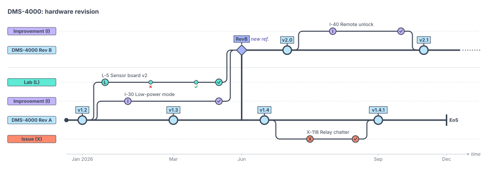
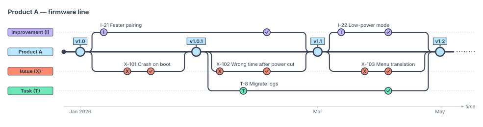

# HPB - Horizontal Product Branch

**Branch-and-merge for the product, not the code: one picture for how hardware, firmware and software evolve.**

[](https://doi.org/10.5281/zenodo.24355435)
[](LICENSE-CC-BY-4.0.md)
[](LICENSE)
[](https://github.com/AchrafBr1/horizontal-product-branch/actions/workflows/ci.yml)



This repository holds the **HPB methodology** (the paper, its LaTeX sources and a short normative
guide) and **HPB Markup**, an open-source toolkit that draws HPB diagrams from a few lines of text.

**Contents:** [What is HPB](#what-is-hpb) · [Why](#why) · [The seven rules](#the-seven-rules) ·
[Notation](#the-notation-at-a-glance) · [Read the paper](#read-the-paper) ·
[Draw HPB diagrams from text](#draw-hpb-diagrams-from-text) · [Playground](#playground) ·
[How to cite](#how-to-cite) · [License](#license)

---

## What is HPB

Draw the product, not the work. Each product reference is a thick horizontal **main line** running
left to right in time. Its versions sit on it as **baselines**: released ones left of the NOW
marker, planned ones to the right. Everything you do to the product is a typed **branch**: it leaves
the main line at the released baseline it started from and comes back to the version that closes
it, or ends in a cross with a written reason. Improvements and lab work run above the line, defects
and tasks below. When a hardware change creates a new reference, the line itself forks. A planned
version is a **gate**: it ships only when the work committed to it has passed verification.

## Why

I have managed complete products (hardware, firmware and software) for more than seven years, across
a large portfolio with constant rotation of references, continuous improvement requests and
competitive pressure. Backlogs, Kanban, Scrum, roadmaps, Stage-Gate and PLM change orders each
solve part of the job, but none of them answers the three questions I am asked every week:

1. **From which version did this work start?**
2. **What else is running on the same product right now?**
3. **Which release actually closed it?**

Software teams answer exactly these questions for code with branch-and-merge. HPB applies the same
idea to the product.

## The seven rules

| Rule | In one line |
| --- | --- |
| **R1** Single origin | Every branch forks from exactly one released baseline, fixed when the work is accepted (for a defect: the version where it was seen). |
| **R2** Explicit closure | Every closed branch ends in exactly one way: merged into one baseline, or discarded with a written reason. |
| **R3** Time moves forward | A branch merges only into a baseline that comes after its origin, on the same line or a descendant of it. |
| **R4** Gate integrity | A planned version is released only when every branch committed to it is verified and everything it depends on is released. |
| **R5** Lineage and life cycle | A non-interchangeable hardware change creates a new line linked to its parent; references are never edited in place, and a retired reference takes no new work. |
| **R6** Typed work | Every branch has one type; sub-tasks and test runs are steps of a branch, not branches of their own. |
| **R7** Traceable discussion | Every comment, decision or piece of evidence is attached to one line, baseline or branch, and the record is append-only. |

The normative text is **[The HPB Guide](methodology/HPB-Guide.md)**; the formal model is in
Appendix A of the paper.

## The notation at a glance

```text
  lane +2   L  lab evolution   ┐ above the line: how the product gets better
  lane +1   I  improvement     ┘
  lane  0   ━━●━━━━━━●━━━━━━●━━━━┃NOW┃─ ─ ─ ○ ─ ─   main line = the product
  lane -1   X  issue (defect)  ┐ below the line: what is wrong and how it is fixed
  lane -2   T  task            ┘

  left of NOW: history, solid, never redrawn    right of NOW: the plan, dashed, expected to change
```

| Glyph | Element | Meaning |
| --- | --- | --- |
| Thick line, solid then dashed | Main line | The product reference: history left of NOW, plan right of it. |
| Filled circle with a tag | Released baseline | A released version. Immutable. |
| White circle with a date | Planned baseline | A planned version and its release gate. `!` badge: target date passed. |
| Diamond | Hardware baseline | A hardware revision; captioned *new ref.*, it starts a new line (line fork). |
| Lettered start node (I, L, X, T) | Branch | Opens at its fork baseline and runs on the lane of its type. |
| Path rejoining the line | Merge | Ends at the version that closed the branch. |
| Gray path ending in a cross | Discard | Closed without a version, with a mandatory rationale. |
| Dashed continuation into a gate | Targeted branch | Committed to a planned version; must be verified before it ships. |
| Small nodes on a branch | Steps | Done, to do, test passed, test failed. |

Every category is encoded at least twice (position, letter, shape, line style), so diagrams survive
grayscale printing and color-vision deficiency.

## Read the paper

> **Horizontal Product Branch (HPB): A Practitioner's Methodology for Planning and Tracing Product
> Evolution across Hardware, Firmware and Software.**
> Achraf Bouchtarouif El Khiat. Preprint, version 1.0, November 2026.

- **PDF:** [paper/HPB-v1.0.pdf](paper/HPB-v1.0.pdf) (the exact file archived on Zenodo)
- **DOI:** [10.5281/zenodo.24355435](https://doi.org/10.5281/zenodo.24355435)
- **LaTeX sources:** [paper/](paper/) (`main.tex`, sections, TikZ figures and the `hpb.sty` notation package)
- **Short normative version:** [methodology/HPB-Guide.md](methodology/HPB-Guide.md)

The paper defines HPB through the seven rules, a standard notation, an operating guide (practices,
cadence, roles, adoption path) and metrics that fall out of the graph. All examples in it are
illustrative.

## Draw HPB diagrams from text

HPB Markup turns a few lines of text into a conforming HPB diagram, as a clean, accessible SVG.
Statement order is time order, and the toolkit checks the HPB rules that can be decided from text
(**R1–R3 in full, R4 as an open-branch release gate, R5–R7 in part**; see the [language reference, §4](docs/language.md#rules)), reporting every problem with its line and column. A green
`hpb validate` means "no rule violation that text can show", not "certified HPB".

```hpb
hpb "Product A — firmware line"
line A "Product A"
release v1.0 @2026-01
improvement I-21 "Faster pairing"
issue X-101 "Crash on boot"
release v1.0.1 merges X-101
issue X-102 "Wrong time after power cut"
task T-8 "Migrate logs"
release v1.1 @2026-03 merges I-21, X-102
improvement I-22 "Low-power mode"
issue X-103 "Menu translation"
release v1.2 @2026-05 merges T-8, I-22, X-103
```



### Quick start

> **npm: coming soon.** The packages `@hpb/core`, `@hpb/web`, `@hpb/react`, `@hpb/cli` and
> `remark-hpb` are ready but **not published yet**, and there is no CDN build yet. Until then,
> build from source:

```sh
git clone https://github.com/AchrafBr1/horizontal-product-branch.git
cd hpb
pnpm install        # Node 20+ and pnpm 9
pnpm -r build
```

**HTML (no build step)**

```html
<!-- the bundle built in this repository; a CDN link will follow the npm release -->
<script src="packages/web/dist/hpb.min.js"></script>

<pre class="hpb">
line A "Product A"
release v1.0
issue X-1 "Crash on boot"
release v1.0.1 merges X-1
</pre>

<hpb-diagram theme="auto" src="roadmap.hpb"></hpb-diagram>
```

The bundle renders every `pre.hpb` and `code.language-hpb` block on load, registers
`<hpb-diagram>` and exposes a Mermaid-style `window.HPB` API. Working page:
[examples/html](examples/html/index.html).

**React / Vite**

```tsx
import { HpbDiagram } from "@hpb/react"; // npm: coming soon; inside this repo, the workspace build
import source from "./roadmap.hpb?raw";   // Vite: import any .hpb file as text

export function Roadmap() {
  return <HpbDiagram code={source} theme="auto" onNodeClick={({ kind, id }) => console.log(kind, id)} />;
}
```

Working app: [examples/vite-react](examples/vite-react).

**Next.js (App Router, Server Component, zero client JavaScript)**

```tsx
import { readFileSync } from "node:fs";
import path from "node:path";
import { renderHpbToString } from "@hpb/react/server";

const source = readFileSync(path.join(process.cwd(), "roadmap.hpb"), "utf8");

export default function Page() {
  return <div dangerouslySetInnerHTML={{ __html: renderHpbToString(source, { idPrefix: "roadmap" }) }} />;
}
```

Working app, including the `.hpb` import rule for webpack and Turbopack: [examples/nextjs](examples/nextjs).

**Any JavaScript, Node or SSR**

```js
import { renderSVG, validate } from "@hpb/core";

const svg = renderSVG(source, { theme: "default" }); // a string; no DOM needed
const problems = validate(source);                    // [{ severity, code, message, line, col }]
```

**Markdown** (remark/unified and markdown-it)

````md
```hpb
line A "Product A"
release v1.0
improvement I-1 "Dark mode"
release v1.1 merges I-1
```
````

```js
import remarkHpb from "remark-hpb";                 // unified, Astro, Docusaurus
import markdownItHpb from "remark-hpb/markdown-it"; // VitePress, Eleventy
```

**CLI** (from the repository, after `pnpm -r build`)

```sh
node packages/cli/dist/cli.js render roadmap.hpb -o roadmap.svg --theme mono
node packages/cli/dist/cli.js validate docs/examples/*.hpb --strict   # exit code 1 on errors
```

Once published: `npm install -D @hpb/cli`, then `hpb render` and `hpb validate`.

Everything else (every statement, rule check, diagnostic code and theme) is in the
[language reference](docs/language.md) and the [integration guide](docs/integration.md). Release
notes: [CHANGELOG.md](CHANGELOG.md).

### Packages

| Package | What it does |
| --- | --- |
| [`@hpb/core`](packages/core) | Parser, rule checks, deterministic layout and pure-string SVG renderer. No dependencies. |
| [`@hpb/web`](packages/web) | Auto-render, the `<hpb-diagram>` element and the `hpb.min.js` bundle. |
| [`@hpb/react`](packages/react) | `<HpbDiagram>` (SSR-safe, interactive) and `@hpb/react/server`. |
| [`@hpb/cli`](packages/cli) | `hpb render` and `hpb validate`. |
| [`remark-hpb`](packages/remark-hpb) | remark/unified and markdown-it plugins for ` ```hpb ` fences. |

## Playground

**[achrafbr1.github.io/horizontal-product-branch](https://achrafbr1.github.io/horizontal-product-branch/)**: write HPB Markup and see the
diagram, the diagnostics and the SVG live. *Available once GitHub Pages is enabled for this
repository.* Meanwhile, after building, open [playground/index.html](playground/index.html) locally
or build the self-contained page with `pnpm --filter @hpb/playground build`.

## Repository layout

```text
hpb/
├── paper/              The HPB paper: LaTeX sources, hpb.sty, figures, HPB-v1.0.pdf
├── methodology/        The HPB Guide: short normative definition of HPB 1.0
├── packages/
│   ├── core/           @hpb/core   parser, rule checks, layout, SVG renderer
│   ├── web/            @hpb/web    browser bundle and <hpb-diagram>
│   ├── react/          @hpb/react  React component and server renderer
│   ├── cli/            @hpb/cli    hpb render / hpb validate
│   └── remark-hpb/     Markdown plugins
├── examples/           html, vite-react, nextjs and the reference fixtures A–E
├── playground/         Live editor (static page)
├── docs/               Language reference, integration guide, rendered examples
├── scripts/            Release checks
├── CITATION.cff        Citation metadata (GitHub "Cite this repository")
└── LICENSE             MIT (code) · LICENSE-CC-BY-4.0.md (methodology and paper)
```

## How to cite

If you use HPB, its notation or HPB Markup in your work, please cite the paper:

> Bouchtarouif El Khiat, A. (2026). *Horizontal Product Branch (HPB): A Practitioner's Methodology
> for Planning and Tracing Product Evolution across Hardware, Firmware and Software* (Preprint
> v1.0). Zenodo. https://doi.org/10.5281/zenodo.24355435

```bibtex
@misc{bouchtarouif2026hpb,
  author    = {Bouchtarouif El Khiat, Achraf},
  title     = {Horizontal Product Branch ({HPB}): A Practitioner's Methodology for
               Planning and Tracing Product Evolution across Hardware, Firmware
               and Software},
  year      = {2026},
  month     = nov,
  publisher = {Zenodo},
  doi       = {10.5281/zenodo.24355435},
  url       = {https://doi.org/10.5281/zenodo.24355435},
  note      = {Preprint v1.0}
}
```

GitHub's **Cite this repository** button reads the same data from [CITATION.cff](CITATION.cff).

## License

HPB is dual-licensed:

- **Code**: the HPB Markup toolkit (`packages/`, `examples/`, `playground/`, `scripts/`) and the
  LaTeX package `paper/hpb.sty` are released under the [MIT License](LICENSE).
- **Methodology**: the paper and its text (`paper/`, except `hpb.sty`), the HPB Guide
  (`methodology/`) and the notation specification are released under
  [CC BY 4.0](LICENSE-CC-BY-4.0.md). Copy, translate and adapt them, with credit.

## Author

**Achraf Bouchtarouif El Khiat** — senior product manager, 7+ years running complete products
(hardware, firmware and software) across a large, high-rotation portfolio. HPB grew out of the gaps
I found in existing methods while doing that job.
[achrafbouchtarouif@gmail.com](mailto:achrafbouchtarouif@gmail.com) ·
[Issues and ideas](https://github.com/AchrafBr1/horizontal-product-branch/issues)
