# HPB Markup language reference (v1.0)

HPB Markup is a small text language for **Horizontal Product Branch (HPB)** diagrams. You
describe what happened to a product line, one event per line, and the renderer draws the
diagram with the HPB notation: the product line as a thick horizontal line, released and
planned baselines on it, and one lane per branch (improvement, issue, task, lab) that forks
from a baseline and merges back into a later one.

If you know Mermaid's `gitGraph`, the idea is the same: **the order of the statements is the
order of time**. Every statement that creates an event gets the next column of the diagram.

```hpb
hpb "Minimal diagram"
line A "Product A"
release v1.0
issue X-1 "Crash on boot"
release v1.0.1 merges X-1
```

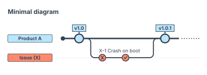

All the images in this page were produced from the `.hpb` files in
[`docs/examples/`](examples/) with the CLI (`hpb render docs/examples/<name>.hpb`).

Contents

1. [Lexical rules](#1-lexical-rules)
2. [Concepts in one minute](#2-concepts-in-one-minute)
3. [Statements](#3-statements)
4. [Model rules R1–R7](#rules)
5. [Diagnostics](#5-diagnostics)
6. [Rendering: what each glyph means](#6-rendering-what-each-glyph-means)
7. [Options, `config` and themes](#7-options-config-and-themes)
8. [Complete examples](#8-complete-examples)
9. [Tips and patterns](#9-tips-and-patterns)
10. [Grammar summary](#10-grammar-summary)

---

## 1. Lexical rules

| Item | Rule |
| --- | --- |
| Statements | One per line. Blank lines and indentation are ignored. |
| Keywords | Case-insensitive (`Release`, `RELEASE` and `release` are the same). |
| Ids | `[A-Za-z0-9._-]+` — e.g. `A`, `v1.0.1`, `Rev-B`, `X-101`, `fw_2026.03`. Ids are case-sensitive. |
| Strings | In double quotes: `"Crash on boot"`. Typographic quotes `“ ”` are accepted. `\"` inserts a quote, `\\` a backslash. A `#` inside a string is text, not a comment. |
| Comments | `#` or `%%` start a comment that runs to the end of the line. |
| Dates | `@YYYY-MM` or `@YYYY-MM-DD` (e.g. `@2026-03`, `@2026-03-15`). Must be a real calendar date. |
| Lists | Comma-separated ids: `merges I-21, X-102, T-8`. |
| Reserved words | `from`, `on`, `targets`, `merges`, `force` and `into` cannot be used as ids. |

Files are UTF-8; a BOM and Windows line endings are accepted. The usual file extension is
`.hpb`, and the usual Markdown fence language is `hpb`.

## 2. Concepts in one minute

- **Line** — a product line (a product, a hardware revision, a firmware stream). Drawn as the
  thick main line of a horizontal band. A diagram can have several lines, one band each.
- **Baseline** — a version on a line. *Released* baselines are filled circles with a square
  tag; *planned* baselines are hollow dashed circles to the right of NOW. Hardware baselines
  are diamonds (a hardware revision creates a new reference).
- **Branch** — a unit of work that forks from a released baseline, runs on its own lane, and
  ends exactly once: merged into a baseline, discarded, or still open at NOW. Four types:

  | Type | Letter | Lane side | Typical use |
  | --- | --- | --- | --- |
  | `improvement` | I | above the main line | feature, enhancement |
  | `lab` | L | above the improvements | research, prototype, lab validation |
  | `issue` | X | below the main line | defect, bug, field return |
  | `task` | T | below the issues | maintenance, chores, migrations |

- **Time** — ordinal: statement order is time order. Dates are optional; they only feed the
  month ticks of the time axis and are checked to be non-decreasing.
- **NOW** — the boundary between history (left) and plan (right).

## 3. Statements

Optional clauses of a statement may be written in any order (`release v1.1 @2026-03 merges I-21`
and `release v1.1 merges I-21 @2026-03` are equivalent).

### 3.1 `hpb` — header

```
hpb ["Title"]
```

Optional. Sets the document title, drawn above the diagram and used as the accessible title of
the SVG. It should be the first statement (otherwise warning `W-HEADER`).

```hpb
hpb "DMS-4000: hardware revision"
```

### 3.2 `config` — diagram settings

```
config <key> [=] <value>
```

| Key | Values | Default | Effect |
| --- | --- | --- | --- |
| `theme` | `default`, `mono`, `dark`, `auto` | `default` | Colour theme (see [§7](#7-options-config-and-themes)). |
| `labels` | `full`, `ref`, `none` | `full` | Branch labels: `"X-101 Crash on boot"`, `"X-101"`, or nothing. |
| `showClosed` | `true`, `false` | `true` | `false` hides merged and discarded branches; merged ones are counted in the badge of the baseline they merged into. |
| `time` | `ordinal`, `linear` | `ordinal` | `linear` is accepted but not implemented in v1.0: the ordinal axis is used and info `I-LINEAR` is reported. |

Keys are case-insensitive. An unknown key is a warning (`W-CONFIG`); a wrong value is an error
(`E-CONFIG`). Options passed to the renderer (`renderSVG(text, { theme: "dark" })`, the
`--theme` flag of the CLI, the `theme` prop of `<HpbDiagram>`) take precedence over `config`.

```hpb
config showClosed = false
config labels ref
```

### 3.3 `line` — declare a product line

```
line <lineId> ["Label"] [from <hardwareBaseline>]
```

Declares a product line and its label (shown in the legend column). **The first line declared
is the current line**: statements without `on` apply to it until `use` switches. Re-declaring an
existing line only updates its label.

If a document never declares a line, an implicit line `main` labelled "Main" is used.

**Line fork** — `line RB "Rev B" from RevB` declares a *child line* whose origin is the hardware
baseline `RevB`. `RevB` must have been released before with kind `hardware`
(`release RevB hardware ...`) on the parent line. The renderer moves that diamond to the start of
the child line's band and draws a lineage connector from the parent line. The fork does not
switch the current line: use `on RB` or `use RB` for the child line's events.

```text
line RA "DMS-4000 Rev A"
release v1.3
release RevB hardware merges L-5
line RB "DMS-4000 Rev B" from RevB
release v2.0 on RB
```

Errors: `R5` (the baseline is unknown, not released or not hardware: a new line only starts from a
new hardware reference), `E-DUP-LINE` (a fork re-declares an existing line; parent links never change).

### 3.4 `use` — switch the current line

```
use <lineId>
```

Following statements without `on` apply to `<lineId>`. Error `E-UNKNOWN-LINE` if it was not
declared.

### 3.5 `release` — released baseline

```
release <version> [kind] [@date] [merges <branch>, ...] [force] [on <lineId>]
kind := firmware | software | hardware | other     (default: firmware)
```

Creates a released baseline at the current column on the current line (or on `on <lineId>`).
`merges a, b` merges those open branches into it: their paths rise into the new baseline and end
with a check mark. This is the normal way to close branches into a release.

- `hardware` draws a diamond with an indigo tag and the caption "new ref.".
- Releasing a baseline that was **planned** before (`plan v1.1 ...` then `release v1.1`) turns it
  into a released baseline at this column. Rule **R4** applies: it cannot be released while
  branches that target it are still open — merge them in the same statement, re-target or
  discard them first, or add `force` (warning `W-R4-FORCED`, and a "!" badge on the baseline).
- A planned target date is not kept as the release date: write the date on the `release`.

```text
release v1.1 @2026-03 merges I-21, X-102
release RevB hardware merges L-5, I-30
release v2.0 on RB
```

Errors: `E-DUP-BASELINE` (already released), `R2`, `R3` (for each merged branch), `R4`,
`E-UNKNOWN-BRANCH`, `E-UNKNOWN-LINE`.

### 3.6 `plan` — planned baseline

```
plan <version> [kind] [@date] [targets <branch>, ...] [on <lineId>]
```

Declares a future baseline. Planned baselines are always drawn **to the right of NOW**, in the
order of their `plan` statements, as hollow dashed circles with a dashed tag and the target date
next to the tag. The main line is dashed between NOW and the last planned baseline.

`targets a, b` makes those open branches target it: their paths continue as dashed lines into
the planned baseline, and a light **release gate** band is drawn around it — the version is not
published until every targeted branch is closed (rule R4).

A planned baseline whose date is earlier than the latest date of the history is **overdue**: it
is drawn in red with a "!" badge.

```text
now
plan v2.1 @2026-12 targets I-50, X-211, X-212
plan v2.2 @2027-03
```

`plan` is not a historical event, so it may appear before or after `now`. Errors:
`E-DUP-BASELINE`, `E-TARGET-RELEASED`, `R2` (target of a closed branch), `E-UNKNOWN-BRANCH`.

### 3.7 Branches — `improvement`, `issue`, `task`, `lab`

```
<type> <branchId> ["Title"] [from <version>] [on <lineId>] [targets <plannedVersion>] [@date]
type := improvement | issue | task | lab
aliases: imp, feature → improvement · bug, defect, x → issue · t → task · l, evolution → lab
```

Opens a branch at the current column. The path drops from its fork baseline onto a free lane of
its type and runs to the right until the branch ends.

- **Fork (rule R1)**: by default a branch forks from the **latest released baseline of its line**
  at that moment. `from <version>` forks from another *released* baseline (for example a
  maintenance branch from an older version); the branch then belongs to that baseline's line.
- `on <lineId>` opens it on another line (its latest released baseline is the fork).
- `targets <version>` makes the branch target a planned baseline (same as a later `target`).
- The label `"<id> <title>"` is drawn at the start node (see `config labels`).
- Branch ids share one namespace with baseline ids (`E-DUP-BRANCH` if already used).

```text
improvement I-21 "Faster pairing"
bug X-118 "Relay chatter" @2026-09
task T-8 "Migrate logs" from v1.0
lab L-5 "Sensor board v2" on RA
```

Lanes are packed automatically (greedy interval partitioning per side): a lane is reused once
the branch that used it has closed, so the diagram stays as compact as possible and the result is
deterministic.

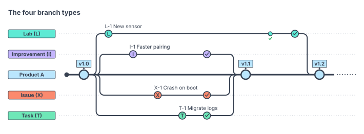

Errors: `R1` (no released baseline to fork from, or `from` a planned baseline),
`E-UNKNOWN-BASELINE`, `E-FORK-LINE` (`from` and `on` disagree), `E-DUP-BRANCH`.

### 3.8 `step` — intermediate node

```
step <branchId> done|todo|pass|fail ["text"] [@date]
```

Adds a small node on the branch at the current column: `done` filled, `todo` hollow, `pass` with
a green ✓, `fail` with a red ✗. Use it for lab tests, reviews, certification runs, field trials.
The text appears in the node's tooltip (`<title>`). A branch that has already ended cannot get
steps (`R2`).

```hpb
hpb "Steps on a branch"
line A "Product A"
release v2.0
lab L-7 "New radio module"
step L-7 done "Prototype"
step L-7 fail "EMC test"
step L-7 todo "Fix shielding"
step L-7 pass "EMC retest"
release v2.1 merges L-7
```

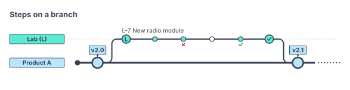

### 3.9 `merge` — merge into a planned baseline

```
merge <branchId> into <version> [@date]
```

Closes the branch **now**, into a baseline that will be released later. The branch is drawn as
*resolved, awaiting release*: a merge node at this column and a dashed path to the planned
baseline. When the planned baseline is later released (`release v1.1`), the branch counts as
merged into it.

To merge into a baseline at the moment it is released, use `release <v> merges <branch>`
instead: a released baseline cannot receive merges from later statements (`E-MERGE-PAST`), and
never one older than the fork (`R3`).

```hpb
release v1.0 @2026-01
issue X-7 "Battery drain"
issue X-8 "Wi-Fi reconnect"
plan v1.1 @2026-04 targets X-8
merge X-7 into v1.1 @2026-02
now
```

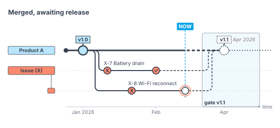

### 3.10 `discard` — close without merging

```
discard <branchId> ["rationale"] [@date]
```

Ends the branch without merging it: grey path, grey terminal with ✕, and the rationale in italics
next to it. If the branch targeted a planned baseline, that target is drawn faded.

```text
discard I-60 "not viable: BOM cost"
discard X-301 "duplicate"
```

### 3.11 `target` — (re)target an open branch

```
target <branchId> <plannedVersion>
```

Makes an open branch target a planned baseline. If it already targeted another one, the previous
target stays visible as a **faded** dashed path (opacity 0.35), which documents the slip. Allowed
after `now`. Errors: `E-UNKNOWN-BASELINE`, `E-TARGET-RELEASED`, `R2` (branch already closed).

```text
plan v3.1 targets I-61
plan v3.2
target I-61 v3.2
```

### 3.12 `now` — the present

```
now
```

Places the NOW column: a dashed sky-blue vertical with a "NOW" pill. After `now` only planning
statements are allowed (`plan`, `target`, `note`, `collapse`, `config`, `use`); historical
events (`release`, branches, `step`, `merge`, `discard`, `eos`, `line`) are errors
(`E-AFTER-NOW`). At most one `now` (`E-DUP-NOW`).

If `now` is omitted, NOW is drawn after the last historical event when the diagram has something
in the future (planned baselines, open branches, merges awaiting release); a pure history has no
NOW marker.

### 3.13 `eos` — end of support

```
eos [lineId] [@date]
```

Draws a perpendicular bar labelled **EoS** on the line (current line by default) at the current
column; the solid main line stops there. Releases or branches on that line after the EoS get
warning `W-AFTER-EOS`. One per line (`E-DUP-EOS`).

```hpb
hpb "Notes and end of support"
line A "Product A"
release v1.0 @2026-01
issue X-9 "Relay chatter"
release v1.0.1 @2026-02 merges X-9
note v1.0.1 "Hotfix shipped to 1,200 units"
eos A @2026-06
```

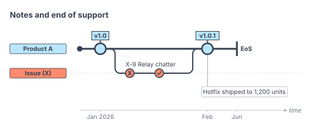

### 3.14 `collapse` — summarise hidden history

```
collapse <version> <count>
```

Adds a dark round badge with the number N under a baseline, meaning "N merged branches are hidden here". Use it to keep long
histories readable; it adds to the count of branches hidden by `config showClosed = false`.

### 3.15 `note` — callout

```
note <lineId|version|branchId> "text"
```

Attaches a callout box to a line, a baseline or a branch, with a thin leader line (rule R7: every
annotation belongs to exactly one node). Use notes sparingly: the decision, the customer, the
reason. Error `R7` if the id names nothing, or names both a line and a baseline or branch.

<a id="rules"></a>
## 4. Model rules R1–R7

The HPB method has seven rules (R1–R7, defined in the white paper). HPB Markup checks every rule
that can be decided from the text of a diagram. **R1–R3 are checked in full, R4 as an open-branch release gate
(not the verification, dependency and launch-bundle parts), and R5, R6 and R7 only in part**, because the rest of what they ask (a test result, a judgement, an audit trail) is not
written in the diagram. A clean `hpb validate` means "no violation that the text can show".

| Rule | Statement | Checked by the toolkit | Typical message |
| --- | --- | --- | --- |
| **R1** Single origin | A branch forks from a **released** baseline: the latest released baseline of its line, unless `from` names another released one. | Yes (`R1`). | `line 'A' has no released baseline to fork 'X-1' from` |
| **R2** Explicit closure | A branch ends **exactly once**: merge or discard (with a rationale), or stays open (drawn to NOW). No steps or re-targets after its end. | Yes (`R2`). A discard without rationale is an `R2` **warning**. | `branch 'X-1' already has a terminal (merged into v1.1)` |
| **R3** Monotonic time | A branch never merges into a baseline **older than (or equal to) its fork**. | Yes (`R3`, `E-MERGE-PAST`). | `'X-1' forked from v1.0 and cannot merge into the older (or same) baseline v1.0` |
| **R4** Gate integrity | A planned baseline is **not released while branches targeting it are open** (the release gate), unless `release ... force`. | Yes (`R4`; `force` gives `W-R4-FORCED`). | `v2.1 cannot be released while targeted branches are open: X-212` |
| **R5** Lineage and life cycle | A hardware change that fails the interchangeability test creates a new line with an explicit parent link; release streams do not. Parent links never change; work respects the life-cycle phase of its line. | Partly: `line ... from` needs a released `hardware` baseline (`R5`), a fork cannot re-declare a line (`E-DUP-LINE`), work after `eos` is flagged (`W-AFTER-EOS`). | `a line fork starts from a released hardware baseline; 'v1' is not one` |
| **R6** Typed work | Every branch has exactly one type; sub-tasks are steps, not branches. | Partly: one known type per branch and one known state per step (`R6`). | `unknown branch type 'epic'` |
| **R7** Traceable discussion | Every annotation is attached to exactly one node; annotations and transitions are append-only. | Partly: every `note` names exactly one existing line, baseline or branch (`R7`). | `a note must be attached to an existing line, baseline or branch` |

### Rules not checked by the toolkit

| Rule (part) | Why it cannot be checked from the text |
| --- | --- |
| R4: every targeted branch is **verified**, dependencies released, launch bundles published together | Verification evidence, dependency links and launch bundles are not part of HPB Markup v1.0. `step ... pass` documents a check but is not required. |
| R5: the **interchangeability test** decides whether a hardware change is a new line | It is an engineering decision. The toolkit only checks that a line fork starts from a hardware baseline. |
| R5: **life-cycle phases** (introduction, maturity, end of sale, ...) | The language only knows end of support (`eos`). |
| R6: a "branch" that is really a **sub-task** of another | A judgement call; model sub-tasks as `step`s. |
| R7: annotations and history are **append-only** | A diagram is a snapshot. Keep the `.hpb` file in version control to get the audit trail. |
| R1, R3: changes of the fork baseline only through an **audited correction** | Same as above: version control holds the history of corrections. |

## 5. Diagnostics

Every problem has a severity, a stable code, a message, and a 1-based line and column.
`validate(text)` (core), `hpb validate` (CLI), the remark plugin (as vfile messages) and
`<HpbDiagram onDiagnostics>` (React) all report the same list. At most one syntax error is
reported per line, so a file that is not HPB Markup does not produce one error per character. With errors, `renderSVG` draws an
**error box** listing them (or throws `HpbError` with `onError: "throw"`); warnings and infos never
block rendering.

| Code | Severity | Meaning |
| --- | --- | --- |
| `E-SYNTAX` | error | Unknown statement (with a "did you mean" suggestion), unexpected token, unterminated string, invalid character in an id. At most one per line. |
| `E-NOT-HPB` | error | More than half of the lines are not valid HPB Markup: probably not an HPB file (reported once, at 1:1). |
| `E-DATE` | error | Date is not `@YYYY-MM` / `@YYYY-MM-DD`, or not a real date. |
| `E-CONFIG` | error | Invalid value for a known `config` key. |
| `W-CONFIG` | warning | Unknown `config` key. |
| `I-LINEAR` | info | `config time = linear` is not implemented yet; ordinal time is used. |
| `W-HEADER` | warning | The `hpb` header is not the first statement (or appears twice). |
| `E-UNKNOWN-LINE` | error | `use` / `on` / `eos` names an undeclared line. |
| `E-UNKNOWN-BRANCH` | error | `step`, `merge`, `discard`, `target`, `merges`, `targets` name an unknown branch (or a baseline). Not repeated for an id whose opening statement was already rejected. |
| `E-UNKNOWN-BASELINE` | error | `from`, `into`, `target`, `collapse` name an unknown baseline. |
| `E-DUP-BASELINE` | error | A baseline is released twice, or planned with an id that exists. The message names the earlier definition and its line. |
| `E-DUP-BRANCH` | error | A branch id is already used by a branch or a baseline (named with its line). |
| `E-DUP-IN-LIST` | error | The same id appears twice in one `merges` or `targets` list (reported at the second one). |
| `E-DUP-LINE` | error | A line fork re-declares an existing line. |
| `E-DUP-NOW` | error | More than one `now`. |
| `E-DUP-EOS` | error | More than one `eos` on the same line. |
| `E-FORK-LINE` | error | A branch's `from` baseline belongs to a different line than its `on`. |
| `E-TARGET-RELEASED` | error | `target` / `targets` names a baseline that is already released. |
| `E-MERGE-PAST` | error | `merge b into v` where `v` was released by an earlier statement. Use `release v merges b`. |
| `E-AFTER-NOW` | error | A historical event after `now`. |
| `R1` – `R7` | error | Model rules, see [§4](#rules). `R5`: line fork from a baseline that is not a released hardware baseline. `R6`: unknown branch type or step state. `R7`: a note that names no node, or two. |
| `R2` | warning | A `discard` without a rationale. |
| `W-R4-FORCED` | warning | A baseline was released with `force` while targeted branches were still open. |
| `W-DATE-ORDER` | warning | A date is earlier than a previous date (statement order is time order). |
| `W-AFTER-EOS` | warning | A release or branch happens on a line after its end of support (rule R5, life cycle). |
| `E-OPTION` | warning | A renderer option passed through the API is invalid (e.g. `theme: "drak"`); the default is used. Line and column are 0: it is not in the source. With `onError: "throw"`, a `TypeError` is thrown instead. |

Example (CLI):

```
$ hpb validate roadmap.hpb
roadmap.hpb:5:7: error [R3] Rule R3: 'X-1' forked from v1.0 and cannot merge into the older (or same) baseline v1.0.
   5 | merge X-1 into v1.0
     |       ^^^
roadmap.hpb:6:1: error [E-SYNTAX] Unknown statement 'relase'. Did you mean 'release'?
   6 | relase v2
     | ^^^^^^
2 errors, 0 warnings in 1 file.
```

## 6. Rendering: what each glyph means

The renderer follows the notation of the HPB method exactly (same glyphs, palette and lane
placement), so a diagram written in HPB Markup looks like the diagrams in the method's paper.

| Element | Drawing |
| --- | --- |
| Legend | Left column, one coloured box per lane: "Lab (L)", "Improvement (I)", the line label, "Issue (X)", "Task (T)". |
| Main line | Thick ink line (3 px) from the line origin to NOW or EoS; dashed between NOW and the last planned baseline; dotted continuation to the right edge. |
| Lane guides | Faint dotted line along every lane across the full width. |
| Released baseline | Circle (r 9) filled with the main colour, ink outline; square tag above with the version and a short arrow. |
| Planned baseline | Hollow dashed circle, dashed tag, target date right of the tag; red with "!" when overdue; light gate band when branches target it. |
| Hardware baseline | Diamond filled indigo, indigo tag, caption "new ref.". |
| Branch path | Orthogonal path with rounded corners: drops from the fork baseline (offset half a column so it does not cross the tag), runs on its lane, rises into the merge baseline. |
| Branch start | Circle (r 7) in the type colour with the letter I, X, T or L. |
| Steps | Small circles (r 4): done filled, todo hollow, pass ✓ green, fail ✗ red. |
| Merge terminal | Node with a check mark. |
| Discard | Grey path and node with ✕, rationale in italics. |
| Open branch | Hollow head at NOW. |
| Targeted branch | Dashed continuation into the planned baseline; former targets faded (35 %). |
| Labels | `"<id> <title>"` at the branch start, with a white halo, drawn on top so lines never cross text. |
| NOW | Dashed sky-blue vertical with a "NOW" pill. |
| EoS | Perpendicular bar labelled "EoS". |
| Line fork | Lineage connector from the parent line to the child line's hardware origin; each line has its own band separated by a thin rule. |
| Time axis | Month ticks ("Jan 2026") when any date is present. |
| Badges | Dark round badge with the count of collapsed (hidden) merged branches; "!" for overdue or forced baselines. |

Palette (theme `default`): main `#BAE6FD`, improvement `#C4B5FD`, issue `#FB8A6E`, task
`#6EE7B7`, lab `#5EEAD4`, hardware `#A5B4FC`, discarded `#E5E7EB`, ink `#374151`, guide
`#D1D5DB`, NOW `#0EA5E9`, overdue `#DC2626`, pass `#16A34A`.

**Accessibility.** The static SVG has `role="img"` and `aria-labelledby` pointing to a `<title>`
(the document title or `ariaTitle`) and a `<desc>` that summarises the diagram; every branch and
baseline has its own `<title>` (shown as a tooltip). When `@hpb/web` or `@hpb/react` make the
diagram interactive, the root switches to `role="group"` (`aria-roledescription="HPB diagram"`) and
every branch and baseline becomes a focusable `role="button"` whose `aria-label` is the text of its
`<title>`, so keyboard and screen-reader users reach the same nodes. Text is never smaller than
10 px at scale 1. The `mono` theme does not rely on colour: letters and line styles carry the
meaning.

**Legend.** One chip per product line and per branch type. When a type needs several lanes, the
extra lanes get a small marker of the type colour joined to the chip by a thin bracket.

**DOM contract (for interactive hosts).** Branch groups carry `data-hpb-kind="branch"` and
baselines `data-hpb-kind="baseline"`, both with `data-hpb-id="<id as written in the source>"`.
`@hpb/web` and `@hpb/react` use these attributes for hover dimming and `onNodeClick`; you can do
the same in your own code. See [integration.md](integration.md#interaction-in-your-own-code).

## 7. Options, `config` and themes

Precedence: **renderer options > `config` in the source > defaults**.

| Option | Default | `config` key | Meaning |
| --- | --- | --- | --- |
| `theme` | `"default"` | `theme` | `"default"`, `"mono"` (greyscale, print-friendly), `"dark"`, or `"auto"`: light or dark following the reader's `prefers-color-scheme`. |
| `showClosed` | `true` | `showClosed` | Show merged and discarded branches. |
| `labels` | `"full"` | `labels` | `"full"`, `"ref"` or `"none"`. |
| `colWidth` | `48` | — | Width of one ordinal column (px). |
| `laneHeight` | `40` | — | Height of one lane (px). |
| `padding` | `16` | — | Outer padding (px). |
| `fontFamily` | system sans-serif stack | — | Font for all text. |
| `showTitle` | `true` | — | Draw the document title above the diagram. |
| `ariaTitle` | document title | — | Accessible title. |
| `idPrefix` | hash of the source | — | Prefix of element ids; set a unique one when a page shows the same diagram twice (`@hpb/react`, `@hpb/web` and the Markdown plugins already do). |
| `onError` | `"box"` | — | `"box"` draws the error box; `"throw"` throws `HpbError`. |

| `default` | `mono` | `dark` | `auto` |
| --- | --- | --- | --- |
| 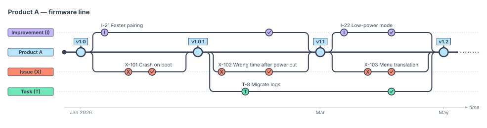 | 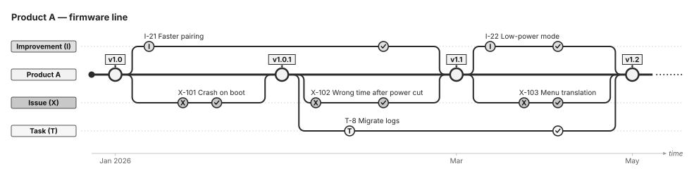 | 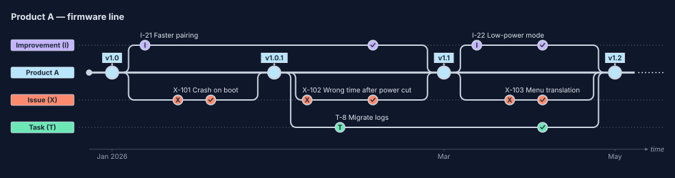 |  |

`auto` writes the light colours as attributes (the fallback for tools without CSS) and a `<style>`
inside the SVG that switches every colour through `--hpb-*` custom properties under
`@media (prefers-color-scheme: dark)`. The variables are declared with zero specificity, so a page
can override them, e.g. `.my-docs svg.hpb { --hpb-background: transparent; }`.

## 8. Complete examples

These five examples are the reference fixtures of the test suite (`examples/fixtures/`). Each one
is the HPB Markup version of the white paper's figure for situations A–E, with the same branches,
baselines and open work (a test compares the counts).

### A. Software / firmware line

```hpb
hpb "Product A — firmware line"
line A "Product A"
release v1.0 @2026-01
improvement I-21 "Faster pairing"
issue X-101 "Crash on boot"
release v1.0.1 merges X-101
issue X-102 "Wrong time after power cut"
task T-8 "Migrate logs"
release v1.1 @2026-03 merges I-21, X-102
improvement I-22 "Low-power mode"
issue X-103 "Menu translation"
release v1.2 @2026-05 merges T-8, I-22, X-103
```


### B. Release gate

```hpb
hpb "Planning with a release gate"
# Situation B of the HPB paper (figures/release-gate.tex), illustrative data.
# v2.1 is a planned baseline with a gate: it cannot be released while I-50,
# X-211 or X-212 is open (rule R4). X-213 is open but not targeted.
line A "Product A"
release v2.0 @2027-01
issue X-210 "Sync error"
improvement I-50 "Multi-user access"
issue X-213 "Display flicker"
release v2.0.1 @2027-02 merges X-210
issue X-211 "Report totals"
issue X-212 "CSV encoding"
step X-212 pass "verified"
step I-50 done "implemented"
now
plan v2.1 @2027-05 targets I-50, X-211, X-212
plan v2.2 @2027-09
```

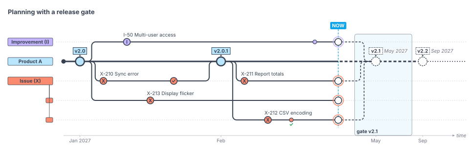

`v2.1` cannot be released until I-50, X-211 and X-212 are merged, re-targeted or discarded (R4).
X-213 is open but not part of the gate. X-212 has passed its verification step.

### C. Hardware revision and line fork

```hpb
hpb "DMS-4000: hardware revision"
# Situation C of the HPB paper (figures/hardware-fork.tex), illustrative data.
# Rev B fails the interchangeability test, so it starts a new line with an
# explicit parent link (rule R5); Rev A keeps its own maintenance until EoS.
line RA "DMS-4000 Rev A"
release v1.2 @2026-01
lab L-5 "Sensor board v2"
improvement I-30 "Low-power mode"
step L-5 fail "EMC test"
release v1.3 @2026-03
step L-5 pass "EMC retest"
release RevB hardware @2026-06 merges L-5, I-30
line RB "DMS-4000 Rev B" from RevB
use RA
release v1.4
release v2.0 on RB
issue X-118 "Relay chatter"
improvement I-40 "Remote unlock" on RB
release v1.4.1 @2026-09 merges X-118
release v2.1 on RB merges I-40
eos RA @2026-12
```

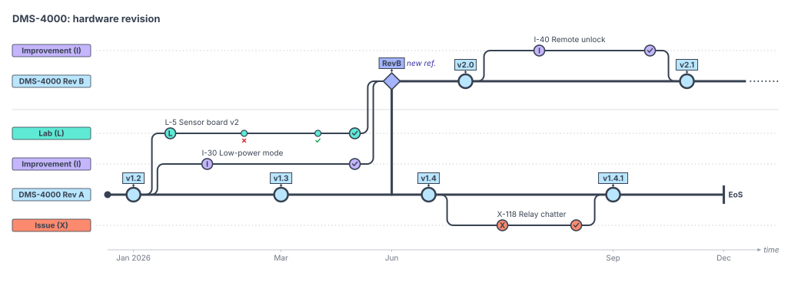

### D. Discards and re-targeting

```hpb
hpb "Discards and re-targeting"
# Situation D of the HPB paper (figures/discard.tex), illustrative data.
# Discards carry their rationale (rule R2); X-63 was moved from v3.1 to v3.2,
# and the former target stays visible, faded.
line A "Product A"
release v3.0 @2026-07
improvement I-60 "Solar panel"
issue X-52 "Display flicker"
issue X-57 "Screen flickers"
discard I-60 "not viable (unit cost)"
discard X-57 "duplicate of X-52"
release v3.0.1 @2026-09 merges X-52
improvement I-61 "Offline mode"
issue X-63 "OTA timeout"
step X-63 done "fix ready"
now
plan v3.1 @2027-03 targets I-61, X-63
plan v3.2 @2027-06
target X-63 v3.2
```

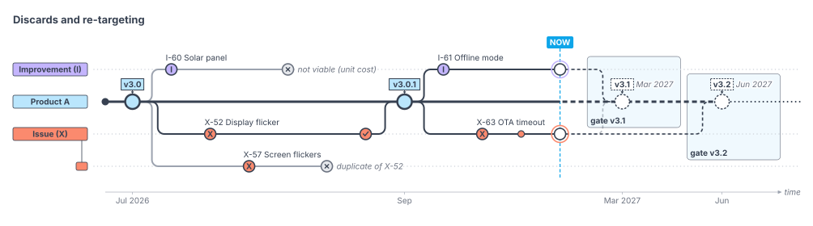

### E. Readability at scale

```hpb
hpb "Readability at scale"
# Situation E of the HPB paper (figures/scale.tex), illustrative data.
# Older releases are collapsed into count badges; eight branches are open at
# NOW, each type gets as many lanes as it has overlapping branches, and lanes
# freed by the merges into v2.2 are reused by I-45 and X-95.
line B "Product B"
release v1.0
collapse v1.0 14
task T-14 "EMC re-test"
release v1.1
collapse v1.1 9
release v2.0
collapse v2.0 21
lab L-5 "Radio module"
task T-20 "Field logs"
issue X-88 "Rare reboot"
release v2.1
collapse v2.1 12
lab L-7 "Antenna tuning"
improvement I-42 "Fleet dashboard"
improvement I-41 "Quick setup"
issue X-90 "Clock drift"
release v2.2 merges I-41, X-90
improvement I-45 "Voice UI"
issue X-95 "Pairing"
now
```

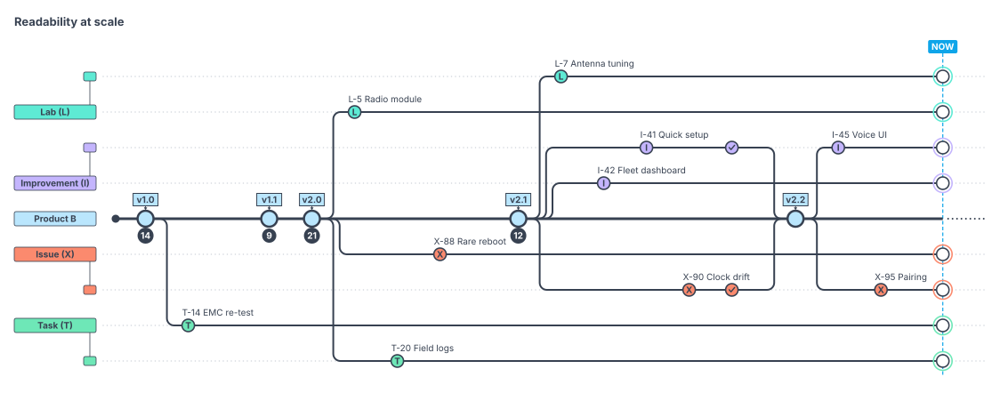

### Forced release

```hpb
hpb "Forced release (R4 overridden)"
line A "Product A"
release v1.0
issue X-1 "Crash on boot"
issue X-2 "Slow menu"
plan v1.1 targets X-1, X-2
release v1.1 merges X-1 force
```

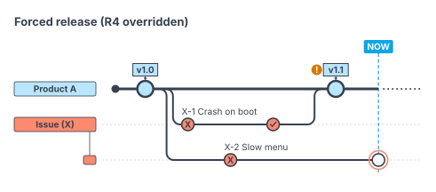

## 9. Tips and patterns

- **Write it as a changelog.** One statement per event, in the order things happened. Moving a
  line up or down moves the event in time.
- **Close branches in the release.** `release v1.1 merges I-21, X-102` is clearer than a series
  of `merge` statements; keep `merge ... into` for work that is done but waits for a planned
  version.
- **Maintenance branches** fork from an older version with `from`:
  `issue X-140 "Security fix" from v1.0` then `release v1.0.2 merges X-140`.
- **Hardware revisions**: release the new reference as `hardware`, then fork a line from it if the
  revision is a separate product reference (`line RB "Rev B" from RevB`).
- **Plan with gates.** Put `now` after the last historical event, then `plan` the next versions
  with `targets`. Re-target slipped work with `target`, so the slip stays visible.
- **Keep it readable.** For long histories use `config showClosed = false` and `collapse`. Use
  `config labels = ref` when titles are long. Split very different products into separate diagrams
  rather than many lines in one.
- **Ids are references.** Use the ids of your tracker (`X-101`, `JIRA-42`) so diagram and backlog
  speak the same language; `onNodeClick` gives you the id to open the ticket.
- **Validate in CI.** `hpb validate docs/**/*.hpb` fails the build on errors; `--strict` also on
  warnings.
- **Dates are optional.** Add them to the events people ask about (releases, plans); the axis only
  needs a few to be useful. Dates never move events: order does.

## 10. Grammar summary

```
document   := header? statement*
header     := "hpb" string?
statement  := config | line | use | release | plan | branch | step | merge | discard
            | target | now | eos | collapse | note
config     := "config" key "="? value
line       := "line" id string? ("from" vid)?
use        := "use" id
release    := "release" vid { kind | date | "merges" idlist | "force" | "on" id }
plan       := "plan" vid { kind | date | "targets" idlist | "on" id }
kind       := "firmware" | "software" | "hardware" | "other"
branch     := btype bid { string | "from" vid | "on" id | ("targets" | "target") vid | date }
btype      := "improvement" | "imp" | "feature" | "issue" | "bug" | "defect" | "x"
            | "task" | "t" | "lab" | "l" | "evolution"
step       := "step" bid ("done" | "todo" | "pass" | "fail") { string | date }
merge      := "merge" bid "into" vid date?
discard    := "discard" bid { string | date }
target     := "target" bid vid
now        := "now"
eos        := "eos" { id | date }
collapse   := "collapse" vid integer
note       := "note" (vid | bid) string
date       := "@" YYYY "-" MM ("-" DD)?
idlist     := id ("," id)*
id         := [A-Za-z0-9._-]+
string     := '"' ( '\' any | not '"' )* '"'
comment    := ("#" | "%%") to end of line
```

`{ ... }` means "any of these clauses, in any order, each at most once".
